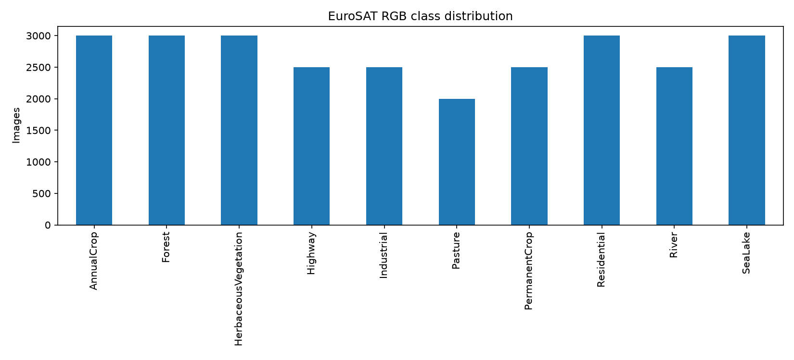
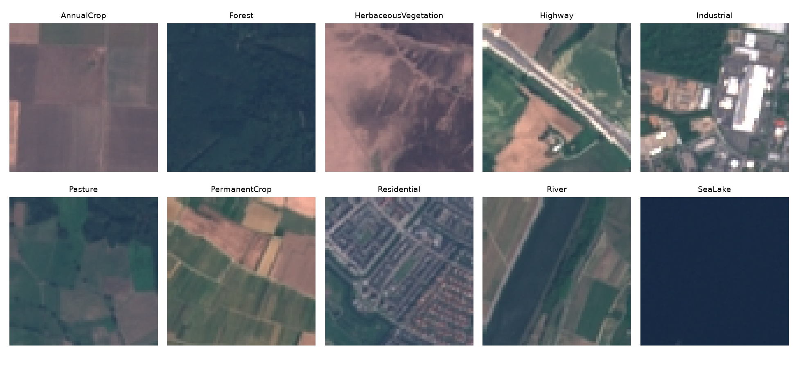
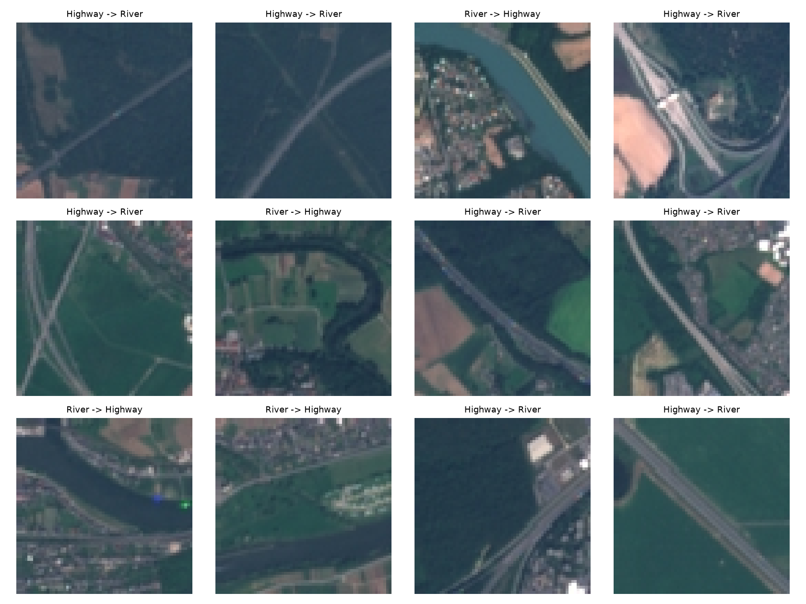
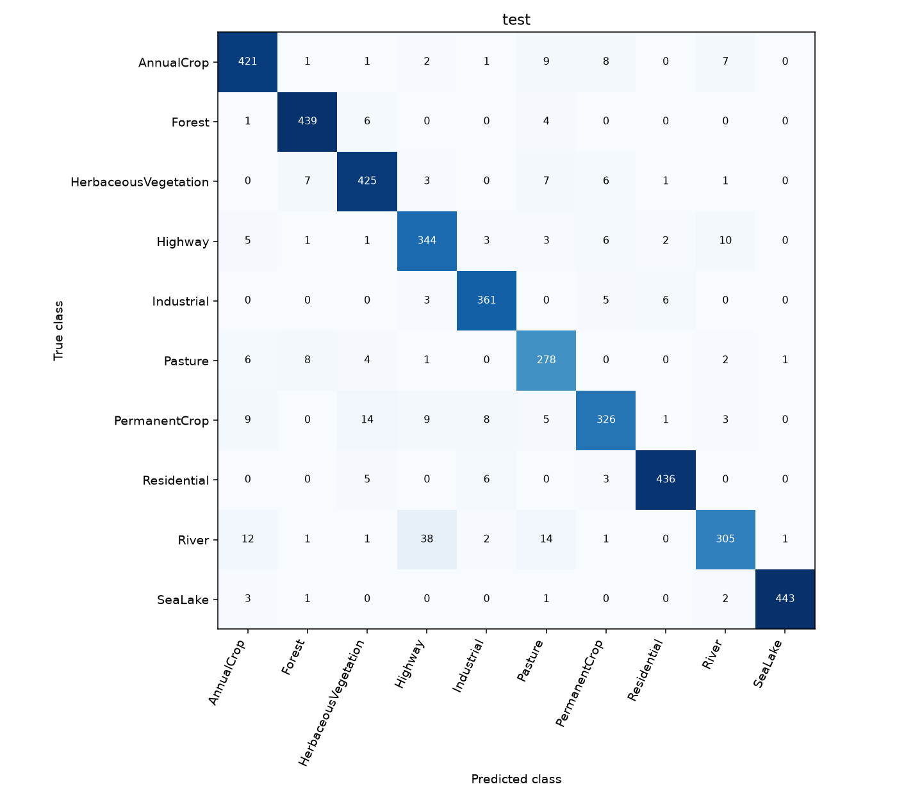
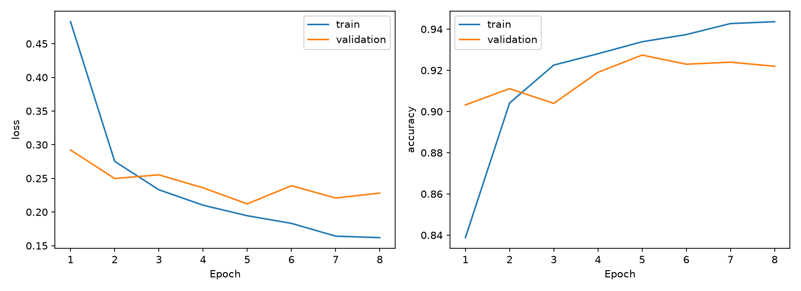
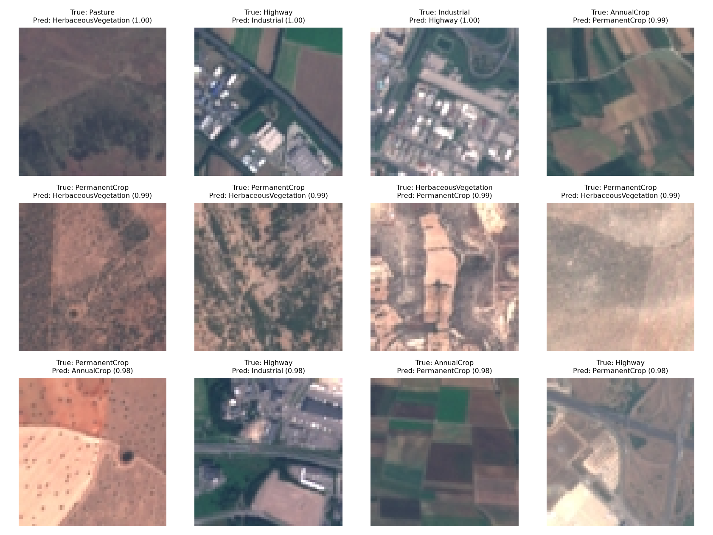

# Satellite Land Use Classification Using CNN and Transfer Learning

This project classifies small RGB satellite image patches into ten land-use classes. It compares a small CNN learned from scratch with an ImageNet-pretrained MobileNetV2 feature extractor. The goal is a manageable experiment whose preprocessing, model choices, and errors can be explained independently.

## Dataset and preparation

Use the already extracted EuroSAT RGB directory; the scripts never download the dataset. Class folder names supply the labels. `prepare.py` decodes each JPEG individually, records dimensions, checks SHA-256 byte duplicates, and generates class counts and representative images. It stops if corrupt or byte-identical files are found rather than silently leaking duplicate files across splits.

The local audit found 27,000 valid 64×64 RGB images, no corrupt files, and no byte-identical duplicates. Counts are 3,000 each for AnnualCrop, Forest, HerbaceousVegetation, Residential, and SeaLake; 2,500 each for Highway, Industrial, PermanentCrop, and River; and 2,000 for Pasture. The largest-to-smallest ratio is 1.5. I kept unweighted training and use macro metrics to make weaker classes visible.




The fixed seed is 42. A stratified 70/15/15 split is saved in `results/splits.csv` with paths relative to the dataset root. No exact path appears in multiple splits. This does not establish geographical independence: nearby satellite patches can still share visual information. This is a patch classification benchmark, not an estimate of performance in an unseen geographical region.

## Models and experimental setup

The CNN uses three convolution/pooling blocks (16, 32, 64 filters), global average pooling, a 64-unit dense layer, dropout 0.2, and ten softmax outputs. Pixel values are scaled to [0, 1].

MobileNetV2 uses ImageNet weights, resizes the 64-pixel images to 96 pixels, and scales values to [-1, 1]. Upsampling does not add spatial information. The feature extractor is frozen, including batch-normalization statistics, so only the new dense head learns. This tests whether features learned from ordinary photographs transfer to satellite patches. Better performance is not assumed.

Both models use Adam (learning rate 0.001), sparse categorical cross-entropy, batch size 64, and training-only horizontal/vertical flips. Images stream through `tf.data` with four loading workers and one prefetched batch, avoiding a full in-memory image cache. TensorFlow uses eight computation threads and two inter-operation threads to avoid oversubscribing this CPU and exhausting memory.

Early stopping monitors validation loss with patience three; the checkpoint with minimum validation loss is evaluated. Training and validation curves are saved. Validation supports error analysis and model development. The separate `--stage test` command evaluates the final saved checkpoint on the held-out test set.

## How to run

From this project directory in PowerShell, create a Python 3.13 environment and install dependencies:

```powershell
python -m venv .venv
.\.venv\Scripts\python.exe -m pip install -r requirements.txt
$data = 'C:\path\to\EuroSAT_RGB'
.\.venv\Scripts\python.exe prepare.py --data $data
.\.venv\Scripts\python.exe train.py --data $data --model cnn --stage smoke
.\.venv\Scripts\python.exe train.py --data $data --model mobilenet --stage smoke
.\.venv\Scripts\python.exe train.py --data $data --model cnn --epochs 15
.\.venv\Scripts\python.exe train.py --data $data --model mobilenet --epochs 15
```

The first MobileNetV2 build needs internet access for pretrained weights; subsequent builds reuse `models/.keras`. A missing weight download is an error, not a fallback to random weights. Seeds improve repeatability but floating-point kernels and package/hardware differences may still change results slightly.

For the exact package versions used here, install `-r results/environment-packages.txt` instead. On this Windows machine, the long project path prevented TensorFlow installation in a nested environment. The successful environment is `C:\Users\tumma\Documents\Codex\sat-env` (Python 3.13.9). From the original workspace, the commands use this interpreter:

```powershell
$python = 'C:\Users\tumma\Documents\Codex\sat-env\Scripts\python.exe'
$data = 'C:\Users\tumma\Downloads\Satellite_Land_Use_Project\EuroSAT_RGB'
& $python outputs\satellite-land-use\train.py --data $data --model cnn --stage validation
```

On another machine, use a similarly short environment path if Windows reports a long-path installation error. `train.py` uses a writable local temporary folder for Keras checkpoint saving because this sandbox's default temporary directory denied file creation.

After inspecting validation errors, the optional controlled rotation experiment is:

```powershell
.\.venv\Scripts\python.exe train.py --data $data --model cnn_rotation --stage smoke
.\.venv\Scripts\python.exe train.py --data $data --model cnn_rotation --epochs 15
```

It adds only random rotation (up to 90 degrees in either direction), preserving the baseline split, initialization seed, architecture, optimizer, and stopping rule. Compare saved validation metrics before accessing test results. A run refuses to overwrite an existing trained checkpoint; archive that model and its result directory before intentionally repeating it.

The actual trigger was the baseline validation confusion matrix: 115 of 375 Highway images were predicted as River, while 51 River images were predicted as Highway. Highway recall was 35.47%. Inspection of these mistakes showed narrow roads and waterways at different orientations. The hypothesis is that rotations could help learn orientation-independent features. This is not evidence that orientation is the root cause. The plan was saved in `results/experiment_plan.json` before final test evaluation.



For final evaluation after model choices are fixed:

```powershell
.\.venv\Scripts\python.exe train.py --data $data --model cnn --stage test
.\.venv\Scripts\python.exe train.py --data $data --model mobilenet --stage test
.\.venv\Scripts\python.exe train.py --data $data --model cnn_rotation --stage test
.\.venv\Scripts\python.exe report.py
```

`results/` contains split records, plots, epoch histories, predictions, per-class reports, confusion matrices, and metrics. Precision, recall, and F1 are macro averages (each class receives equal weight). Error grids show the twelve highest-confidence mistakes and are not a random sample of errors. `models/` contains local checkpoints and is excluded from Git. The dataset can stay outside this repository; `--data` selects its location. `data/` is also excluded if you choose to move it there.

To regenerate a model's validation reports without retraining, use `train.py --data $data --model cnn --stage validation` (or the other model name). The focused Highway/River grid uses the first twelve matching mistakes in manifest order, rather than the confidence-sorted selection.

## Limitations and future extension

This experiment uses only RGB patches, one split and one seed. It does not use multispectral bands, geolocation-aware splits, confidence calibration, or repeated runs. A frozen ImageNet backbone is only one transfer-learning setup; fine-tuning is future work. Any validation gain from one augmentation run needs repetition before treating it as reliable.

The CNN and MobileNetV2 differ in architecture and input resolution as well as pretraining. Their comparison measures these complete model setups, not the isolated causal effect of ImageNet pretraining. The rotation experiment is the narrower controlled comparison. A 15-epoch cap makes the project manageable but does not establish that either setup has reached its best possible performance.

A deliberate future extension is land-use change detection with geographically aligned, multi-date Sentinel-2 imagery, consistent cloud masking, and season-aware preprocessing. That extension is not implemented. Predictions on two unrelated EuroSAT patches do not constitute meaningful temporal change detection.

## Execution results

All three training runs and their validation evaluations completed. The CNN ran 15 epochs in 236.7 seconds and selected epoch 14. MobileNetV2 stopped after 8 epochs in 472.2 seconds and selected epoch 5. The rotation CNN ran 15 epochs in 275.5 seconds and selected epoch 13. Times cover `model.fit`, including validation/checkpoint work, but exclude imports, model construction, and the later detailed evaluations. Smoke-test metrics are not used as experiment results.

| Model | Validation accuracy | Macro precision | Macro recall | Macro F1 |
|---|---:|---:|---:|---:|
| CNN | 76.20% | 0.7529 | 0.7564 | 0.7503 |
| MobileNetV2 | 92.74% | 0.9249 | 0.9250 | 0.9247 |
| CNN with rotation | 76.37% | 0.7581 | 0.7577 | 0.7527 |

MobileNetV2 was selected using validation macro F1 before any test evaluation. `results/model_selection.json` records that decision. Test results are final comparisons and are not used to modify the models.

| Model | Test accuracy | Macro precision | Macro recall | Macro F1 |
|---|---:|---:|---:|---:|
| CNN | 77.28% | 0.7658 | 0.7668 | 0.7605 |
| MobileNetV2 | 93.28% | 0.9299 | 0.9298 | 0.9292 |
| CNN with rotation | 76.15% | 0.7564 | 0.7555 | 0.7504 |

All test metrics use the same 4,050 held-out images. `results/comparison.csv` contains the unrounded values. The rotation run's small validation gain did not carry through to test accuracy or macro F1. MobileNetV2 had the strongest final result in this setup. Its most frequent test confusion was River→Highway (38 images), followed by PermanentCrop→HerbaceousVegetation and River→Pasture (14 each). Highway→River occurred 10 times.



### Rotation experiment result

Adding rotation produced a small overall validation gain: 0.173 percentage points of accuracy (seven more correct images out of 4,050) and 0.00244 macro F1. Highway recall rose from 35.47% to 44.53%, but River recall fell from 69.33% to 54.40%. Highway→River errors fell from 115 to 54 while River→Highway errors rose from 51 to 101. Combined errors for this pair changed from 166 to 155.

This is a mixed result, not a convincing solution to the confusion. The change largely shifted the direction of errors. I would not recommend it as a reliable improvement without repeated seeds and a closer study of validation errors. No model settings were changed in response to test results.

The completed MobileNetV2 learning curves show training loss continuing to fall after epoch 5 while validation loss fails to improve for three epochs. Early stopping selected epoch 5 instead of the final epoch 8. The baseline CNN did not show the same clear, sustained late training/validation loss divergence within its 15-epoch budget.



In the actual error grids, some Highway patches also contain buildings, and some crop patches have similar field textures. Several wrong predictions have very high softmax confidence. Confidence is therefore not a guarantee of correctness, and no confidence-calibration claim is made. These observations are limited to selected mistakes; they do not establish labeling errors or explain every failure.



### Verification and completion

The full dataset audit, split checks, three architecture/training/save/reload smoke tests, three training runs, three validation evaluations, three held-out test evaluations, and comparison generation completed successfully on CPU. Source syntax compilation and package consistency checks passed. Trained checkpoints and the generated figures are present locally. The interrupted setup and smoke attempts were replaced by successful executions; they are not counted as completed experiments.

`EXECUTION.md` lists successful commands, environment details, and the temporary-directory, network, Windows path-length, and font-cache issues encountered and resolved. No requested training or evaluation step remains incomplete. The multi-date change-detection extension remains deliberately unimplemented. No GitHub push or Git commit was made.
