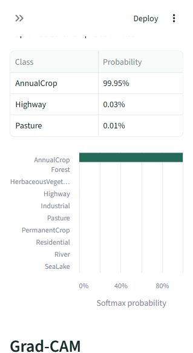
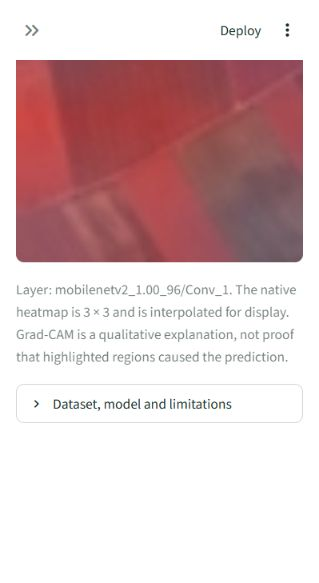

# SatVision — Satellite Land-Cover Intelligence

SatVision classifies RGB satellite image patches into ten EuroSAT classes using an existing trained MobileNetV2 model. The Streamlit app accepts JPEG/PNG uploads or six supplied examples, displays the predicted class, top-three softmax probabilities and all-class probability chart, and offers a class-selectable Grad-CAM overlay.

This is a patch classification project, not a full remote-sensing monitoring platform. No models were retrained during the application upgrade. Original checkpoints, results, plots and split manifests were preserved. The original project README is retained verbatim in [EXPERIMENTS.md](EXPERIMENTS.md), and the original execution history remains in [EXECUTION.md](EXECUTION.md).

## Dataset and method

EuroSAT RGB contains 27,000 Sentinel-2 patches in ten class folders. The completed audit found valid 64×64 RGB images, no corrupt files and no byte-identical duplicates. Class sizes range from 2,000 to 3,000. The seed-42 stratified split contains 18,900 training, 4,050 validation and 4,050 test images with no file-path overlap.

The custom CNN uses three convolution/pooling blocks. The transfer model uses a frozen ImageNet-pretrained MobileNetV2 backbone and a trained classification head. Checkpoints were selected by minimum validation loss; MobileNetV2 was selected by validation macro F1 before final test evaluation. Architecture and resolution also differ, so the comparison does not isolate the effect of pretraining.

| Model | Held-out test accuracy | Macro F1 |
|---|---:|---:|
| Custom CNN | 77.28% | 0.7605 |
| MobileNetV2 (selected) | 93.28% | 0.9292 |
| CNN with rotation | 76.15% | 0.7504 |

These are the original completed experiment results, not measurements from the demo examples. Full precision/recall and unrounded metrics remain in [results/comparison.csv](results/comparison.csv).

## Error analysis and rotation experiment

The CNN confused Highway and River: 115 Highway validation images were predicted as River, and 51 River images as Highway. Adding training-only rotations raised validation accuracy from 76.20% to 76.37% and macro F1 from 0.7503 to 0.7527. Highway→River errors fell to 54, but River→Highway errors rose to 101. The small validation gain did not carry through to test performance. This was a mixed result rather than a reliable fix.

MobileNetV2's most frequent test confusion was River→Highway (38 patches). Mixed road/building patches and visually similar crop textures remain difficult. High softmax probabilities can accompany wrong predictions.

## Run locally

Use Python 3.13 and a short virtual-environment path on Windows:

```powershell
py -3.13 -m venv C:\path\satvision-env
C:\path\satvision-env\Scripts\python.exe -m pip install -r requirements.txt
C:\path\satvision-env\Scripts\python.exe -m streamlit run app.py
```

On this machine, from the original workspace:

```powershell
& 'C:\Users\tumma\Documents\Codex\sat-env\Scripts\python.exe' -m streamlit run outputs\satellite-land-use\app.py --server.address 127.0.0.1 --server.port 8501
```

Open [the local app](http://127.0.0.1:8501). The checkpoint at `models/mobilenet.keras` is loaded directly from the repository, relative to `inference.py`, once through Streamlit's resource cache. This 10.14 MiB checkpoint is allowed by `.gitignore`; other models and caches remain ignored. Its byte count and SHA-256 are verified against `model_asset.json`. A missing or modified checkpoint fails clearly. No release download, network access or model URL is required. See [DEPLOYMENT.md](DEPLOYMENT.md) for Community Cloud setup.

`requirements.txt` contains pinned application dependencies. The former experiment dependency file is retained as `requirements-training.txt`; the original exact training environment remains in `results/environment-packages.txt`. Running the application does not require the complete EuroSAT dataset.

## Preprocessing and Grad-CAM

JPEG decoding uses TensorFlow, matching the training loader. Images are converted to RGB and resized to 64×64 without normalization. The unchanged checkpoint performs its own 96×96 resizing and [-1, 1] scaling. This avoids double normalization. PNG transparency is discarded; non-square uploads are resized to the square model input.

Grad-CAM uses the actual saved nested backbone's `Conv_1` layer. A gradient tape records its features and the original classification head's pre-softmax score. The reconstructed softmax output is checked against the full model. No checkpoint layers, activations or weights are modified. The native feature map is only 3×3; its upsampled overlay is coarse. The user can select a target class and adjust heatmap opacity. A zero positive response is reported rather than replaced with an invented heatmap.

Grad-CAM is qualitative, not proof that highlighted regions caused the prediction. Softmax outputs are not calibrated confidence. Predictions on images unrelated to EuroSAT may be unreliable.

## Local verification

```powershell
python test_app.py
```

The four executed test groups cover model loading/checksum checks; saved class order; exact preprocessing agreement; six real example predictions against original saved outputs; finite normalized probabilities; RGB, grayscale, palette and RGBA PNGs; corrupt/unsupported/oversized inputs; Grad-CAM gradients and class dependence; and Streamlit classification, target selection, slider and upload-mode interactions. AppTest starts the script and verifies that it renders without errors.

The local HTTP server also returned 200 from its health endpoint and was exercised in a browser. The Windows test process peaked at approximately 507 MiB RSS; this includes test overhead and multiple model instances, and is not a measured Cloud memory requirement. Generated evidence is in `app_checks/`. No new accuracy estimate was calculated. Linux wheel resolution is a deployment compatibility check, not a Linux runtime execution or public deployment.





## Limitations and future work

The original experiment uses one seed and a patch-level random split, so geographically nearby images may share information. It does not establish performance in unseen regions. RGB inputs omit other Sentinel-2 bands; resizing does not add detail. Large scenes are not tiled or segmented. Examples are attributed in [examples/ATTRIBUTION.md](examples/ATTRIBUTION.md).

Future temporal change detection requires geographically aligned, multi-date Sentinel-2 imagery, cloud masking and season-aware comparisons. It is not implemented. Comparing predictions for unrelated EuroSAT patches does not constitute meaningful change detection.

Before public deployment, manually include `models/mobilenet.keras` in the GitHub repository along with the application files, then configure Community Cloud with Python 3.13. No commit, push or deployment is performed automatically. See [DEPLOYMENT.md](DEPLOYMENT.md) and [APP_VERIFICATION.md](APP_VERIFICATION.md).
